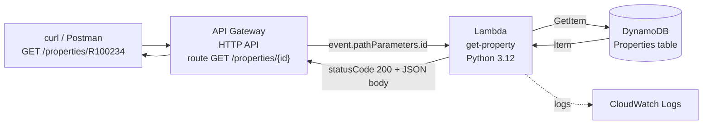

# Week 7: Serverless and Event-Driven Architecture
 
This week I took the `get_property` behavior from PropertyLite (`propertylite/app.py`) and re-hosted it serverless, so it no longer needs an always-on EC2 instance. I also built an SQS queue with a dead-letter queue and debugged a Lambda 500 error using CloudWatch Logs.
 
Region for everything: `us-east-1`.
 
## Request path
 

 
Text version:
 
```
curl -> API Gateway (GET /properties/{id}) -> Lambda get-property -> DynamoDB GetItem
                                                     |
curl <- API Gateway <- {statusCode, JSON body} <-----+---> CloudWatch Logs
```
 
Step by step:
 
1. The client sends `GET /properties/R100234` to the API's Invoke URL.
2. API Gateway matches the route `GET /properties/{id}` and captures `R100234` as `id`.
3. API Gateway invokes the Lambda, passing an `event` containing `pathParameters: {"id": "R100234"}`.
4. The Lambda calls DynamoDB `GetItem` on the `Properties` table, keyed by `L_ListingID`.
5. The Lambda returns `{statusCode: 200, body: <JSON string>}`, and API Gateway sends it back to the client.
## Lab 7.1: API Gateway, Lambda, DynamoDB
 
- **Table:** `Properties` with partition key `L_ListingID` (String), on-demand billing, in us-east-1. Loaded with test rows `R100234` and `R100235`.
- **Lambda:** `get-property`, Python 3.12 (see `lambda_function.py`).
- **IAM:** an inline policy on the Lambda execution role allowing only `dynamodb:GetItem` on `arn:aws:dynamodb:us-east-1:967226344295:table/Properties`. I did not use the broad `AmazonDynamoDBReadOnlyAccess` managed policy, so the function can read one table and nothing else (least privilege).
- **API:** HTTP API `propertylite-api`, route `GET /properties/{id}` integrated with the Lambda, `$default` stage with auto-deploy.
Test:
 
```bash
curl https://08xbwl2f0i.execute-api.us-east-1.amazonaws.com/properties/R100234
# {"L_ListingID": "R100234", "L_Address": "123 Main St", "L_AskingPrice": "650000"}
 
curl https://08xbwl2f0i.execute-api.us-east-1.amazonaws.com/properties/FAKE
# {}
```
 
Same data and JSON shape as the EC2 version, with zero always-on compute. I can explain the IAM policy: the Lambda's role can only call GetItem on the Properties table and nothing else in the account.
 
Design notes:
 
- The boto3 `dynamodb` and `table` objects are created outside the handler so warm invocations reuse them and only cold starts pay the setup cost.
- `json.dumps(..., default=str)` is needed because DynamoDB returns numbers as `Decimal`, which `json.dumps` cannot serialize and would cause a 500.
- The path parameter name `id` in the route must match `event['pathParameters']['id']` in the code.
## Lab 7.2: SQS with a dead-letter queue
 
```bash
# 1. Create the dead-letter queue
aws sqs create-queue --queue-name property-dlq --region us-east-1
 
# 2. Get its ARN
aws sqs get-queue-attributes --region us-east-1 \
  --queue-url https://sqs.us-east-1.amazonaws.com/967226344295/property-dlq \
  --attribute-names QueueArn
# arn:aws:sqs:us-east-1:967226344295:property-dlq
 
# 3. Redrive rule saved in attrs.json
# {"RedrivePolicy":"{\"deadLetterTargetArn\":\"arn:aws:sqs:us-east-1:967226344295:property-dlq\",\"maxReceiveCount\":\"3\"}"}
 
# 4. Create the main queue with that rule attached
aws sqs create-queue --queue-name property-queue --attributes file://attrs.json --region us-east-1
 
# 5. Send a message
aws sqs send-message --region us-east-1 \
  --queue-url https://sqs.us-east-1.amazonaws.com/967226344295/property-queue \
  --message-body '{"PropertyId":"P1002"}'
 
# 6. Receive it
aws sqs receive-message --region us-east-1 \
  --queue-url https://sqs.us-east-1.amazonaws.com/967226344295/property-queue
```
 
Result: `receive-message` returned the message with `Body` equal to `{"PropertyId":"P1002"}`, so the queue stored and delivered it correctly.
 
How it works: `property-queue` holds messages until a consumer processes and deletes them. When a message is received, it becomes invisible for the visibility timeout (30 seconds by default). If the consumer does not delete it in that time, it reappears and its receive count goes up. Once a message has been received 3 times (`maxReceiveCount`) without being deleted, SQS moves it to `property-dlq`. This way a failing message cannot loop forever, and it can be inspected later.
 
Request/response vs event-driven: the API path above is request/response (the caller waits for the answer), while SQS is event-driven (the sender drops a message and moves on, and a worker handles it later). A DLQ does not notify anyone by itself. In production I would add a CloudWatch alarm on the DLQ's `ApproximateNumberOfMessagesVisible` metric that publishes to an SNS topic, so a person is alerted when messages land there.
 
## Lab 7.3: Debugging an API Gateway 500
 
Symptom: curl returns `{"message": "Internal Server Error"}`.
 
Process: do not guess from the outside. Go to Lambda, Monitor, View CloudWatch logs, open the most recent invocation, and read the stack trace.
 
| Error in CloudWatch logs | Cause | Fix |
|---|---|---|
| `AccessDeniedException` | Execution role policy scoped to the wrong table ARN (for example `Property` instead of `Properties`) | Correct the `Resource` ARN in the inline policy |
| `KeyError: 'id'` or `'pathParameters'` | Route deployed as `/properties` instead of `/properties/{id}`, so the event has no path parameter | Recreate the route as `GET /properties/{id}` |
| `ResourceNotFoundException` | Wrong table name, or Lambda in a different region than the table | Match the table name and region (I hit this by creating the Lambda in us-east-2 first while the table was in us-east-1) |
| `TypeError: Object of type Decimal is not JSON serializable` | Missing `default=str` in `json.dumps` | Add `default=str` |
 
Lesson: CloudWatch Logs is always the first move with a Lambda error, because the API response alone never tells you enough.
 
## Files
 
- `lambda_function.py`: the Lambda handler
- `postman_collection.json`: Postman collection (import it, then change the `base_url` variable if your API URL differs)
- `curl-tests.sh`: the same tests as curl commands
- `README.md`: this file
 
