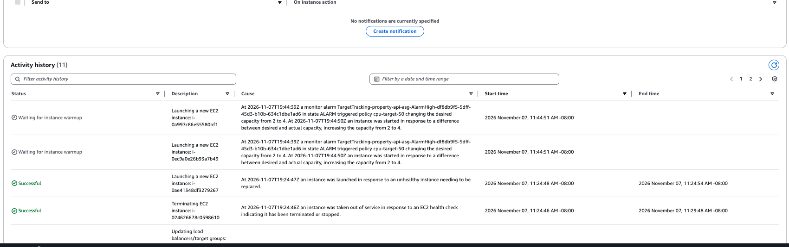
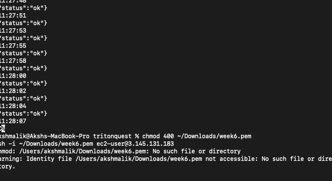
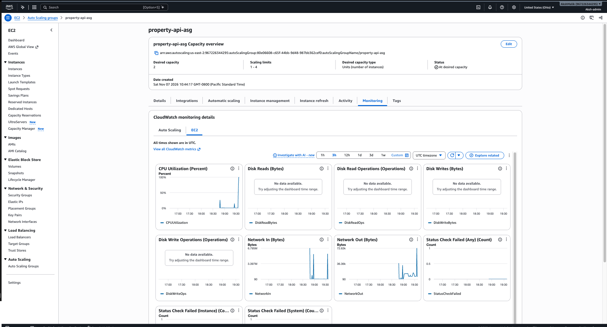
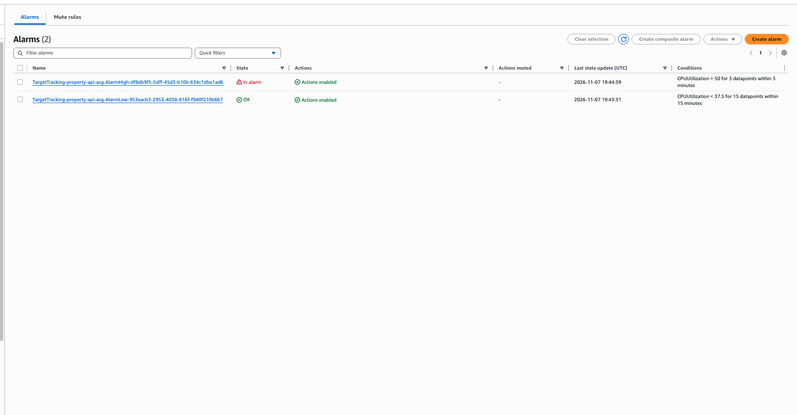
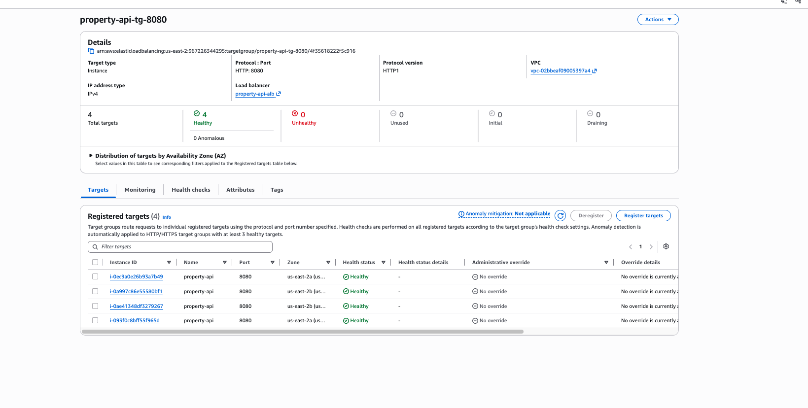

# Week 6: Load Test Report (ALB + Auto Scaling)

**Date:** 2026-11-07
**Region:** us-east-2 (Ohio)
**App:** PropertyLite (Flask, port 8080) behind an Application Load Balancer, managed by an Auto Scaling group

## Summary

PropertyLite went from a single EC2 instance (Week 3) to an Auto Scaling group of 2 instances across two Availability Zones, behind an internet-facing ALB.

- **Self-healing:** a manually terminated instance was replaced by the ASG **2 seconds** later, and the app stayed available through the ALB the whole time.
- **Scaling:** a CPU stress test pushed average CPU to ~100%. The target tracking alarm fired at **11:44:39**, the ASG raised desired capacity from **2 to 4** at **11:44:50**, and both new instances were **healthy and serving traffic by ~11:48**. That's about **5 minutes** from load spike to extra capacity in service.

## Architecture

```
Browser
   │  HTTP :80
   ▼
property-api-alb  (internet-facing, public subnets in us-east-2a + us-east-2b, SG: alb-sg)
   │  listener HTTP:80 → forward
   ▼
property-api-tg-8080  (HTTP :8080, health check GET /health)
   │
   ▼
property-api-asg  (min 1 / desired 2 / max 4, launched from property-api-template)
   ├── instance(s) in us-east-2a
   └── instance(s) in us-east-2b      (SG: property-api-sg)
```

**Deviation from the handbook:** the handbook places the instances in private subnets behind a NAT Gateway. To stay within free tier, I created `training-vpc` with **no NAT Gateway** and ran the instances in the **public subnets** (auto-assign public IPv4 enabled). The instances are still not directly reachable on 8080: `property-api-sg` only allows 8080 from `alb-sg`.

## Configuration

| Component | Setting |
|---|---|
| VPC | `training-vpc` (10.0.0.0/16), 2 public + 2 private subnets, no NAT Gateway |
| Launch template | `property-api-template`, Amazon Linux 2023, `t3.micro`, key pair `week6`, SG `property-api-sg`, detailed monitoring on |
| User data | Installs Python + Flask 3.0.3, writes `app.py` and `rets_property_sample.csv` to `/opt/property-api`, runs the app as a systemd service (`Restart=always`) |
| `alb-sg` | Inbound HTTP 80 from `0.0.0.0/0` |
| `property-api-sg` | Inbound TCP 8080 from `alb-sg` (security group reference), SSH 22 from my IP |
| Target group | `property-api-tg-8080`, HTTP:8080, health check path `/health` |
| Load balancer | `property-api-alb`, internet-facing, listener HTTP:80 → `property-api-tg-8080` |
| Auto Scaling group | `property-api-asg`, min 1 / desired 2 / max 4, both public subnets, Balanced best effort |
| ASG health checks | EC2 + ELB, grace period 300 s |
| Scaling policy | `cpu-target-50`: target tracking, Average CPU Utilization, target 50, instance warmup 300 s |

### Alarms created by the target tracking policy

| Alarm | Condition | Effect |
|---|---|---|
| `TargetTracking-property-api-asg-AlarmHigh-...` | CPUUtilization > 50 for 3 datapoints within 3 minutes | Scale out |
| `TargetTracking-property-api-asg-AlarmLow-...` | CPUUtilization < 37.5 for 15 datapoints within 15 minutes | Scale in |

Scale out reacts in 3 minutes and scale in waits 15 minutes, and the 37.5 vs 50 gap prevents flapping.

## Test 1: Self-healing (Lab 6.2, part A)

**Method:** polled the ALB every 2 seconds, then terminated one instance from the EC2 console.

```bash
while true; do curl -s http://<alb-dns-name>/health; echo " $(date +%T)"; sleep 2; done
```

| Event | Time (PST) | Instance |
|---|---|---|
| Instance terminated manually (us-east-2b) | 11:24:46 | `i-024626678c0598610` |
| ASG launched replacement (us-east-2b) | 11:24:48 | `i-0ae41348df3279267` |
| Replacement launch complete | 11:24:54 | `i-0ae41348df3279267` |

**Result:** the replacement launch started **2 seconds** after termination, in the **same AZ**, so the group stayed balanced across 2a and 2b. The polling loop kept returning `{"status":"ok"}` because the ALB routed all traffic to the surviving instance.




## Test 2: Scale out under CPU load (Lab 6.2, part B)

**Method:** SSH'd into both running instances and ran a CPU stress test on each:

```bash
sudo dnf install -y stress-ng          # Amazon Linux 2023 (amazon-linux-extras is AL2 only)
stress-ng --cpu 2 --timeout 600s       # t3.micro has 2 vCPUs → ~100% CPU
```

I stressed **both** instances on purpose. The policy tracks the group's *average* CPU, so stressing one instance gives (100 + 0) / 2 ≈ 50%, which sits right on the target and may never trigger scaling.

### Timeline

| # | Event | Time (PST) | Gap from previous |
|---|---|---|---|
| 1 | Stress test (re)started on both instances | ~11:43 | |
| 2 | `AlarmHigh` → **In alarm** | 11:44:39 | ~1 to 2 min* |
| 3 | Policy `cpu-target-50` set desired **2 → 4**, ASG launched `i-0ec9a0e26b93a7b49` (2a) and `i-0a997c86e55580bf1` (2b) | 11:44:50 | 11 s |
| 4 | Both new instances **healthy** in `property-api-tg-8080` (4/4 healthy) | ~11:48 | ~3 min |
| | **Total: load spike → new capacity serving traffic** | | **~5 min** |

\* Faster than the normal ~3 minutes because CPU was already high from an earlier stress run when the policy was created (see Issue 2), so the alarm's first 3 datapoints were all above 50.

### Why 4 instances and not 3

Target tracking scales proportionally instead of one instance at a time:

```
current average CPU / target = 100 / 50 = 2
new desired = 2 instances × 2 = 4   (also the configured max)
```

After scale out, the group was 2 instances in us-east-2a and 2 in us-east-2b, all healthy.






## Test 3: Scale in after load ends

stress-ng stopped automatically at ~11:53. `AlarmLow` requires 15 minutes below 37.5%.

| Event | Time (PST) |
|---|---|
| Stress test ended | ~11:53 |
| `AlarmLow` → In alarm | _TBD_ |
| ASG lowered desired capacity (4 → _TBD_) | _TBD_ |
| Extra instances terminated | _TBD_ |

With all instances idle, target tracking may scale all the way down to **min 1**, not back to 2. It only aims for 50% CPU and doesn't remember the original desired count.


## Issues hit and fixes

### 1. All targets unhealthy, ASG kept replacing instances
- **Symptom:** ~5 minutes after launch (right when the 300 s grace period ended), the ASG terminated an instance "in response to an ELB system health check failure" and launched a replacement.
- **Root cause:** the first target group was created as **HTTP:80**, but Flask listens on **8080**. Every health check hit a port with nothing listening (and blocked by `property-api-sg`), so every instance looked unhealthy.
- **Fix:** a target group's port can't be edited, so I created `property-api-tg-8080` (HTTP:8080, `/health`), pointed the ALB's HTTP:80 listener at it, attached it to the ASG, and deleted the old group. Both targets went healthy within minutes.
- **Lesson:** the listener port (80, on the ALB) and the target port (8080, on the instance) are separate settings. The ASG was behaving correctly the whole time, just acting on bad health data, so check the target group's Targets tab first.

### 2. CPU at 100% but no scaling
- **Symptom:** CloudWatch showed 0 alarms even though CPU was at ~100%.
- **Root cause:** the ASG was created with **no scaling policy** (page 4 of the ASG wizard was left on "No scaling policies").
- **Fix:** created the target tracking policy `cpu-target-50` under ASG → Automatic scaling. AWS created the AlarmHigh/AlarmLow pair automatically, and AlarmHigh fired about a minute later.
- **Lesson:** no `TargetTracking-...` alarms in CloudWatch means there's no target tracking policy.

### 3. SSH timed out
- **Root cause:** the SSH rule in `property-api-sg` allowed my IP from when I created it. My public IP had changed since then (different network).
- **Fix:** updated the rule's source to **My IP** (current address).
- **Lesson:** "Operation timed out" means the security group is blocking the connection, while a key problem gives "Permission denied."

### 4. Private key stored inside the git repo
- Found `week6.pem` in the repo folder. Moved it to `~/.ssh/`, set `chmod 400`, and added `*.pem` to `.gitignore`.

## Key takeaways

- **ALB** distributes requests across healthy targets and never creates or removes instances.
- **ASG** keeps running instances equal to desired capacity: it replaces failed instances (self-healing) and changes desired capacity through the scaling policy (elasticity).
- **The target group links them:** the ASG registers and deregisters instances, and the ALB health checks them and routes to the healthy ones.
- **CloudWatch notices, alarms decide, and the ASG acts.**
- **Security group references** (`source = alb-sg`) are what let only the ALB reach the instances, even though the ALB's IPs change.

## Cleanup

- [ ] Delete Auto Scaling group `property-api-asg` (terminates its instances and its scaling alarms)
- [ ] Delete load balancer `property-api-alb`
- [ ] Delete target group `property-api-tg-8080`
- [ ] Delete launch template `property-api-template`
- [ ] (Optional) Delete security groups `property-api-sg` and `alb-sg`, then `training-vpc`
